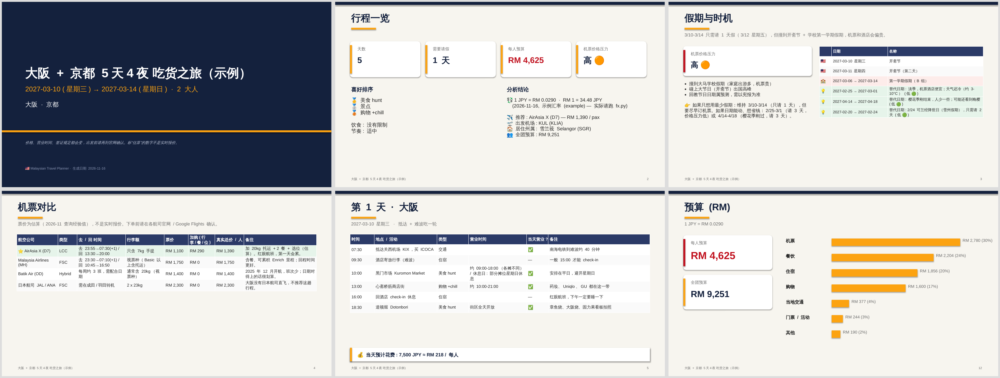

# 🇲🇾 Malaysian Travel Planner, an AI Skill for Malaysians going abroad

> 专为马来西亚人设计的出国旅行规划 Skill。装进 Claude 后，它会先问你问题，再帮你算马币、比机票、查大马假期、看店家营业时间、推荐当地美食，最后生成 **Excel + PPT 详细攻略**。
>
> A Claude Skill that plans overseas trips **from a Malaysian point of view** and hands you an **Excel + PowerPoint** guide.

---

## ✨ 它会做什么 / What it does

| | 功能 | Feature |
|---|---|---|
| 🗣️ | 先问问题（可点选）：目的地、日期、州属、可请几天假、预算、饮食（清真/不吃猪肉）、喜好排序 | Interviews you first (clickable options where supported) |
| 💱 | 所有价钱都换算成 **RM**（实时汇率，Excel 里改汇率会自动重算） | Every cost in **RM**, with a live FX rate and editable Excel formulas |
| ✈️ | 比较 **MAS、AirAsia、Batik Air、当地航空**，按“真实总价”（票价 + 行李 + 餐 + 选位）排序 | Compares airlines by **true total cost**, not headline fare |
| 📅 | 分析 **大马公共假期 + 学校假期**（按你的州，包括补假和吉打/吉兰丹/登嘉楼的周五周六周末），算要请几天假、机票会不会贵，并帮你找“请 3 天放 9 天”的时段 | Malaysian public + school holidays **per state**, fare-pressure score, leave-bridging finder |
| 🕘 | 检查每个景点 / 店家 **星期几营业、几点到几点**，避免白跑 | Checks **opening days and hours** for every stop |
| 🍜 | 推荐 **当地特色美食**，标注清真 / 含猪肉 | Local must-eats with **halal / pork** labels |
| 🛍️ | 告诉你这家店 **大马有没有、值不值得** 特地去 | “**Does Malaysia already have it? Worth it?**” for shops and food chains |
| ⚖️ | 按你的喜好排序分配时间：🏛️ 景点 / 🛍️ 城市购物+chill / 🍜 美食 hunt | Allocates time by your ranking of sightseeing / shopping+chill / food hunt |
| 📊 | 输出 **Excel 攻略**（总览、假期分析、机票、每日行程、美食、购物、RM 预算、清单） | **Excel** guide |
| 📽️ | 输出 **PPT 攻略**（封面、一览、假期、出行日历、机票、每日一页、美食、购物、预算、清单） | **PowerPoint** guide |
| 🗓️ | **出行日历**：一眼看到哪天请假、哪天公共假期、哪天学校假期 | Trip calendar: leave, public & school holidays at a glance |
| ✅ | 出文件前**自动检查**：汇率有没有倒过来、有没有排到休息日、清真用户有没有被推荐猪肉、有没有超预算 | Pre-flight checker catches inverted FX, closed-day clashes, diet conflicts, over-budget |

深度支持：🇯🇵 日本 · 🇰🇷 韩国 · 🇹🇭 泰国 · 🇹🇼 台湾 · 🇻🇳 越南 · 🇨🇳 中国。其他国家会用上网搜索的方式处理。
语言：中文 / English / Bahasa Melayu（由用户选择）。

📅 **2027 请假攻略（16 个州/直辖区）**：[中文](docs/2027-leave-hacks.zh.md) · [English](docs/2027-leave-hacks.en.md)，例如雪兰莪请 3 天假可以放 9 天。

👉 示例输出 / Sample output：[`examples/`](examples/)（大阪 + 京都 5 天 4 夜）



---

## 📥 安装 / Install

### 方法 1：Claude 网页版 / 桌面 App（claude.ai）
1. 到 [Releases](../../releases) 下载 `malaysian-travel-planner.zip`（或自己打包：`./build_zip.sh`）
2. Claude → **Settings → Capabilities**：确认 **Code execution and file creation** 已开启
3. 在 **Skills** 区块按 **Upload skill**，上传那个 zip
4. 开新对话，说：「我想去日本玩 5 天，帮我规划」

### 方法 2：Claude Code
```bash
git clone https://github.com/willietengg/malaysian-travel.git
```
```bash
mkdir -p ~/.claude/skills && cp -r malaysian-travel/malaysian-travel-planner ~/.claude/skills/
```
```bash
pip install openpyxl python-pptx
```

### 其他 AI 工具（ChatGPT 等）
`SKILL.md` 是普通的 Markdown 文件，可以放进其他工具使用：
- 建一个 Custom GPT，把 `SKILL.md` 的内容贴进 Instructions，再把 `references/`、`data/`、`scripts/` 上传成 Knowledge，并开启 Code Interpreter。
- 这个用法**还没有完整测试**，问问题的界面和生成文件的功能可能和 Claude 不一样。

---

## 💬 使用示例 / Example prompts

- 「下个月想去韩国 6 天，我在槟城，可以请 3 天假，帮我规划」
- 「2027 年我只有 4 天年假，帮我找最划算的出国时段，雪兰莪」
- "Plan a 5-day Bangkok food trip for 2 adults from KL, halal only, budget RM 2,500 each."
- 「Saya nak pergi Taiwan 5 hari bulan Mac, dari Johor. Tolong rancang.」

---

## 🗂️ 结构 / Structure

```
malaysian-travel-planner/          ← 这个文件夹就是 Skill
├── SKILL.md                       ← 主流程（问问题 → 分析 → 出文件）
├── data/
│   ├── my_holidays.json           ← 大马公共假期 + 学校假期（各州）
│   └── destination_peaks.json     ← 各国旺季 / 节日 / 休息期
├── scripts/
│   ├── holidays.py                ← 假期分析、请假时段搜索、全年请假攻略
│   ├── check_trip.py              ← 出文件前的自动检查
│   ├── fx.py                      ← RM 汇率
│   ├── make_excel.py              ← 生成 Excel
│   └── make_ppt.py                ← 生成 PPT
├── references/                    ← 问卷、航空公司对比、大马品牌表、各国资料
└── examples/osaka-kyoto-5d.json   ← 完整示例
```

自己跑脚本 / Run the scripts yourself:

```bash
cd malaysian-travel-planner/scripts
```
```bash
python holidays.py check --state SGR --country JP --start 2027-03-10 --end 2027-03-14
```
```bash
python holidays.py windows --state PNG --leave 3 --country KR
```
```bash
python holidays.py hacks --state SGR --year 2027
```
```bash
python check_trip.py ../examples/osaka-kyoto-5d.json
```
```bash
python make_excel.py ../examples/osaka-kyoto-5d.json osaka.xlsx && python make_ppt.py ../examples/osaka-kyoto-5d.json osaka.pptx
```

---

## ⚠️ 注意 / Disclaimer

- 机票价格是**估算**，不是实时报价。AI 没有订票系统的接口，攻略会附上官网和 Google Flights 链接让你自己查。
- 回教节日日期属**预测**，以政府宪报为准。内置假期资料涵盖 2026 年 11 月到 2027 年 12 月。
- 签证、入境规定、营业时间都会变，出发前请到官网确认。

## 🤝 贡献 / Contributing

欢迎提交 PR，尤其是：每年更新假期表、补充“大马有没有”品牌表、新增国家资料。详见 [CONTRIBUTING.md](CONTRIBUTING.md)。

## 📄 License

MIT
